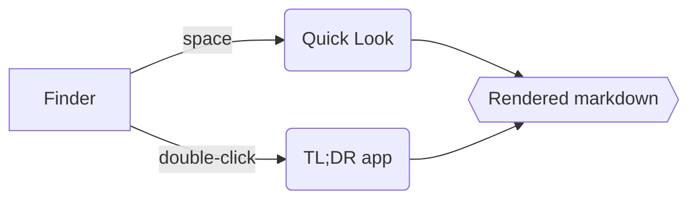

# TL;DR

A **native** macOS viewer with *Quick Look* support. Links: [Apple](https://apple.com), [jump to tables](#tables).

> [!NOTE]
> GitHub-style alerts work too.

## Lists

- Tight list
- With `inline code`
  - Nested item

1. First
2. Second

- [x] Done
- [ ] Todo

## Code

```swift
let html = MarkdownRenderer.renderPage(markdown: text, title: "x", baseURL: nil)
print("<escaped> & safe")
```

## Tables

| Feature     | App | Quick Look |
|:------------|:---:|-----------:|
| GFM         | ✅  | ✅         |
| Live reload | ✅  | —          |

~~Strikethrough~~, <kbd>⌘</kbd>+<kbd>R</kbd>, and a rule:

---

> Plain blockquote.

## Diagram


